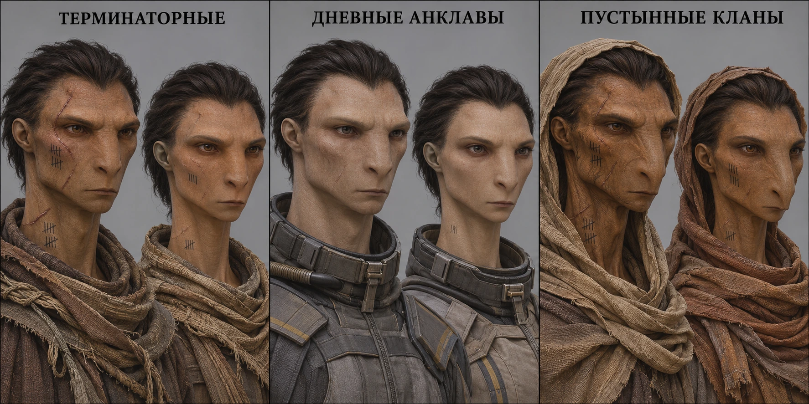

# Заргаши: актуальные концепты

Основа — [досье](../../race_zargashi.md#biology.variation). Млекопитающеподобный вид, почти голая кожа и волосы на голове. Терминаторные — базовый тип; дневные анклавы — светлее и несколько крупнее; пустынные — суше, темнее, с усиленной носовой областью.

- [Три популяции, мужчина и женщина в каждой](three-populations.webp).
- [Пустынные: мужское и женское лица](desert-male-female.webp).
- [Пустынный тип: исследование лица в двух ракурсах](desert-face-study.webp).

Изображения — художественные референсы, не точные антропометрические таблицы. Расположение мужчины слева и женщины справа и небольшие различия лиц не устанавливают обязательного направления полового диморфизма. Одежда дневных анклавов показана частично, на портретах не замкнутый рабочий гермокостюм. Точные формы татуировок, лица отдельных персон и причёски не являются универсальными признаками вида. Прежние человекоподобные и рептильные варианты сюда не включены. Исходные PNG сохранены; эти WebP — компактные копии для документации.
