# Борея: география цивилизации — первый этап

**Рабочий срез: 3290 год.**  
**Статус:** согласованные сведения о расселении, происхождении бункерных, снабжении, сельском хозяйстве, транспорте и северном ледовом регионе перенесены в досье 26.11.2026. Схема материков согласована 26.11.2026 с уточнёнными очертаниями северных материков 2–5; тектоническая схема предварительно согласована. Региональное распределение населения и параметры, отмеченные как предложения, разрабатываются.  
Связанный план: [дорожная карта шести цивилизаций](PLAN_planetarnyh_civilizaciy_New_SRG.md).

## 1. Исходные данные

| Тема | Установлено в текущем лоре | Что ещё не определено |
|---|---|---|
| Размеры планеты | Масса 2,3 земной, радиус 1,3 земного, гравитация 1,35 g | Геометрия суши и точные карты |
| Климат | Холодный фон всей планеты, средняя температура около −8 °C. Геотермальные поля создают локальные микроклиматы | Распределение осадков, местные ветра, течения и положение сезонной кромки льда |
| Суша и вода | Океаны около 60% площади; несколько крупных материков и десятки архипелагов, ледовые моря | Очертания материков, конкретные проливы, число и расположение геотермальных полей |
| Геология | Активная тектоника, богатые металлические руды; крупные поселения на устойчивых участках у геотермальных полей | Границы безопасных участков, распределение промышленных районов |
| Расселение | Высокая урбанизация; основная масса жителей — в экваториально-геотермальных городах. Возможность постоянного расселения вне геотермальных полей возникла задолго до 3290 года; удалённость от источников повышает стоимость жизни (уточнение автора) | Численность и размещение крупнейших агломераций именно на 3290 год; когда именно появилась возможность свободного расселения |
| История | Многократные откаты, ядерная война около −7000, восстановление из изолированных очагов; подъём Дераданской Диктатуры и объединение 2320 года | География старых государств, сохранившиеся территории и их связи |
| Политика | Единое планетарное правительство с внутренней автономией регионов, включая местные монархии и диктатуры | Число регионов, их границы, учреждения, резиденция правительства |
| Население | Около 4 млрд грондаров во всей цивилизации, из них приблизительно 3 млрд на Борее в общем описании; линии активно смешиваются | Точный демографический срез 3290 года; распределение по регионам |

Источники: [досье грондаров](../race_grondary.md) (II.1–II.4, III.18, IV.1–IV.14, VIII.6, X.1, X.5, X.11, XI.2) и [справочник систем](../reference_spravochnik_sistem.md#elder-races.grondary-boreya-zvezda-hiems). Единый срез 3290 требует исключить события войны с ИИ Древних и её последствия. Численность на 3400 год не принимается за значение на 3290.

### Климат и сезонный лёд

Борея остаётся холодной планетой при высокой тектонической активности. Согласно справочнику, она получает около 0,75 земной инсоляции. Для карты 3290 года используем установленную среднюю температуру около −8 °C и температурные диапазоны из [раздела о климате](../race_grondary.md#homeworld.climate). Древняя ядерно-ледниковая зима относится к отдельному историческому срезу.

| Территория | Климатический ориентир | Как показать на карте |
|---|---|---|
| Экваториальные низменности и побережья | Для экваториально-геотермальных областей лето −5…+15 °C, зима −20…−5 °C. Летние дожди возможны в экваториальных зонах | Выделить наиболее мягкие низменности. Их сезонное потепление учитывать отдельно от локальных выходов тепла |
| Средние широты | Зимой −45…−30 °C, коротким летом до +5 °C. Характерны метели и ледяные бури | Намечать тундровые пространства и коридоры расселения с учётом высоты и сезонной доступности |
| Полярные районы и высокогорья | В полярных шапках ниже −40 °C круглый год. Горные ледники требуют отдельной привязки к высоте и местному климату | Отметить постоянные ледники на суше и ориентировочную линию горных снегов |
| Геотермальные оазисы | В пределах самих оазисов около +5…+15 °C круглый год. Только в этих условиях встречается местная древесная форма | Показать компактные участки тёплого микроклимата поверх карты холодных областей. Отдельно отметить соседние устойчивые площадки, пригодные для строительства |
| Моря и проливы | По досье экваториальные акватории освобождаются ото льда сезонно. Морской лёд определяет доступность побережий | Нанести ориентировочные зимнюю и летнюю кромки льда. Для каждого важного пролива и порта определить сезон открытой воды |

Вулканические и геотермальные зоны задают локальные источники тепла, рудные районы и условия строительства. На климатической схеме широта, высота, проливы и конфигурация морей определяют фон для каждого участка. Ретроградное вращение учитывается при последующей проработке ветров и течений. Точные границы зон зависят от будущих контуров материков.

### Открытая вода в 3290 году

В досье зафиксировано преобладание морского льда и сезонное освобождение экваториальных акваторий. Площадь открытой воды зависит от конфигурации моря, местных течений, ветра и сезонности. Средняя температура планеты около −8 °C сама по себе её не определяет. Полыньи могут поддерживаться ветром или притоком более тёплой воды. [NSIDC, физика морского льда](https://nsidc.org/learn/parts-cryosphere/sea-ice/science-sea-ice)

Предлагаемый ориентир для первого эскиза при общей площади морей и океанов около 517 млн км²:

| Состояние | Доля открытой воды от всей площади морей и океанов | Ориентировочная площадь |
|---|---:|---:|
| Сезонный минимум по всей планете | 2–5% | 10–26 млн км² |
| Сезонный максимум по всей планете | 10–20% | 52–103 млн км² |
| Участки с открытой водой круглый год | Менее 1% | До 5 млн км² |

Диапазоны предложены как параметры карты, подлежащие уточнению по контурам суши и океаническим связям. Зимой и летом отдельного берега действуют местные сезоны. Глобальные минимум и максимум описывают суммарное состояние планеты. Доля открытой воды включает участки океана, бухты, проливы и полыньи. Сплошная судоходная трасса требует проходимости всех проливов на маршруте.

Для первого эскиза предлагаются два или три крупных морских бассейна с выраженным сезоном открытой воды. Один из них — ранее намеченное экваториальное море между двумя материками. Остальная открытая вода может приходиться на океанические участки низких широт и разрозненные полыньи. Крупные моря, полностью свободные ото льда круглый год, в первом варианте карты отсутствуют.

### Почему грондары сохраняют холодный климат

Рабочее объяснение для 3290 года — население, хозяйство и инфраструктура приспособлены к холодной Борее, поэтому системный риск глобального потепления превосходит его ожидаемую выгоду. Более долгий сезон открытой воды, расширение возможностей пищевого производства и снижение затрат на отопление могли бы стать аргументами за потепление. При этом экваториально-геотермальные районы в основном укладываются в комфортный для грондаров диапазон от −20 до +20 °C. Им выгодно поддерживать подходящие условия непосредственно в местах проживания и работы. [Досье, комфортная температура](../race_grondary.md#biology.comfort-temperature)

Утрата значительной площади морского льда сократила бы местообитания подлёдных водорослей, важных для морской пищевой цепи и кислородного цикла Бореи. Потепление также потребовало бы перестройки части инфраструктуры на мерзлоте и обновления схем снабжения при смещении сезонов и промыслов. Земные аналоги показывают, что оттаивание ледонасыщенных грунтов может снижать устойчивость существующих дорог и фундаментов. [Досье, флора](../race_grondary.md#homeworld.flora) · [IPCC AR6, мерзлота и инфраструктура](https://www.ipcc.ch/report/ar6/wg1/downloads/report/IPCC_AR6_WGI_Chapter_12.pdf)

Такую осторожность подкрепляет культурная память о ядерной зиме и утрате части биосферы. Предлагаемый приоритет — местное отопление, защищённые производственные пространства и адаптация транспорта. Возможности планетарной инженерии и история предложений о потеплении требуют отдельной проработки. [Досье, влияние планеты на культуру](../race_grondary.md#homeworld.cultural-influence)

## 2. Согласованное решение: географический принцип расселения

**Уточнения автора о срезе 3290 года.** Борея — метрополия межзвёздного государства с колониями и развитой промышленностью. Благодаря ресурсной базе молодой планеты метрополия в основном обеспечивает себя сама. Другие миры дают небольшую долю её снабжения. Межзвёздный уровень развития учитывается в гражданской технике, промышленности и организации перевозок по самой Борее. [Досье, ресурсы](../race_grondary.md#homeworld.resources) · [Досье, колонии](../race_grondary.md#homeworld.settlements)

Борея — не равномерно заселённая суша и не единственная непрерывная экваториальная агломерация. Основу составляет **система отдельных крупных узлов расселения**, возникших на геологически устойчивых территориях рядом с источниками геотермального тепла. Узел может включать несколько городов, прилегающую хозяйственную территорию и связанную с ними периферию. В зрелой цивилизации узлы объединены транспортными и хозяйственными связями. Конкретные технологии и пропускная способность этих связей относятся к отдельному этапу.

Такой принцип следует из уже установленной раздробленности суши, неравномерности обогрева и древней истории изолированных очагов. Он также позволяет объяснить, почему единый народ исторически создал множество государств и почему после объединения сохранилась региональная автономия.

**Уточнение автора (25.11.2026):** технологическая возможность постоянно расселяться вдали от геотермальных источников появилась существенно раньше 3290 года. Геотермальное поле больше не является обязательным условием существования поселения: при пригодности территории для строительства грондары могут жить и вне него. Однако чем дальше от доступного геотермального тепла, тем в общем случае выше стоимость жизни. Историческая концентрация населения и промышленности вокруг источников не исчезает только потому, что расселение стало технически возможным.

Не следует отождествлять геотермальный оазис с площадью всей современной агломерации. В 3290 году возможны и постоянные удалённые города, а не только специализированные форпосты. Предлагаемая экономическая модель учитывает не одну географическую дистанцию: климат, собственные источники энергии, снабжение и масштаб поселения также могут влиять на его расходы. Конкретные технологии и распределение затрат требуют отдельного решения. Дороговизна содержания удалённого поселения сама по себе не означает, что его жители богаче либо беднее жителей тепловых ядер. При радиусе 1,3 земного даже относительно узкая широтная полоса имеет значительную площадь; из числа жителей нельзя напрямую вывести размеры городов без уточнения площади доступной суши, доли хозяйственных территорий и плотности застройки.

### Сейсмика и выбор мест для городов

**Уточнение автора:** в наиболее сейсмически активных зонах Бореи живёт сравнительно мало грондаров. Объекты, привязанные к выходам тепла и месторождениям, могут находиться в этих зонах, тогда как постоянное жильё тяготеет к площадкам с меньшим риском поблизости. Доступность геотермального тепла учитывается вместе с безопасностью площадки.

В средних широтах Бореи регулярно происходят землетрясения магнитудой 6 и выше. Для карты учитываем распределение активных разломов, вулканических зон, глубоких рыхлых отложений, крутых склонов и низких береговых площадок. Степень тряски зависит от места, глубины толчка и строения грунта. Даже твёрдое основание оценивается с учётом близости разломов и склонов. [Досье, геология](../race_grondary.md#homeworld.geology) · [USGS, влияние грунта на сейсмическую тряску](https://www.usgs.gov/publications/local-site-effects-and-dynamic-soil-behavior)

В первом фрагменте карты крупный порт может занимать участок у устья реки, а жилое и административное ядро — скальную террасу поблизости. В геотермальных долинах городские районы размещаются на подходящих устойчивых площадках и получают тепло от ближайших полей. Для будущей проработки городской инфраструктуры следует учесть резервные маршруты и возможность поддерживать отопление отдельных районов при повреждении магистральных сетей. Сейсмическая безопасность также важна при выборе исторического массива для бункерной сети.

Для оценки места поселения учитываем доступность тепла и качество площадки. Это объясняет, почему город может вырасти на устойчивой террасе вдали от дешёвого тепла и снабжаться из соседнего геотермального района или собственных источников.

### Технологические и культурные принципы проектирования (3290 год)

**Уточнение автора от 26.11.2026.** Характеристики техники, общественной инфраструктуры и поселений нужно выводить из уровня развития грондаров, их психологии, отношения к труду и технологической культуры. Общий подход применяется к транспорту, жилью, сельскому хозяйству, энергетике и будущей разработке города.

| Установленная черта грондаров | Следствие для проектирования (рабочий ориентир) |
|---|---|
| Коллективизм, община как производственно-бытовая единица | Развитая общая инфраструктура, коллективное использование дорогостоящего оборудования, централизованные запасы и ремонт. Формы владения конкретной техникой уточняются по устройству местного хозяйства. |
| Прагматизм, аскетизм и престиж производительного труда | Ценность машины определяется её полезностью, надёжностью, ресурсом и затратами на эксплуатацию. Обогрев, изоляция, безопасность и удобство для длительной работы входят в функциональные требования. |
| История катастроф и холодных зим | Высокая ценность ремонта и предсказуемости, запас прочности, возможность поддерживать работу оборудования при перебоях снабжения. Для критических систем поселений учитывается резервирование. |
| Развитая металлургия и сильное промышленное производство | Металлоцентричная конструктивная культура. Возможны современные сплавы и сложные узлы, соответствующие освоенным технологиям. Рабочий ориентир для массовой техники — унификация деталей и ремонт в общинной мастерской или местном сервисном центре. |
| Прикладная направленность науки и стремление к самостоятельному обслуживанию | Новые решения оцениваются по применимости и возможности производить, обслуживать и ремонтировать их внутри государства. Допускается освоение и адаптация чужих разработок. |
| Недоверие к сильному ИИ и неподконтрольным центрам решений | Высокая механизация и специализированная автоматика используются под контролем ответственных грондаров. Рабочие варианты включают проверяемые режимы работы, понятные интерфейсы, возможность вмешательства оператора и обученные ремонтные коллективы. |

Основа: [психология грондаров](../race_grondary.md#psychology), [отношение к ИИ](../race_grondary.md#culture.artificial-intelligence), [архитектурный стиль](../race_grondary.md#culture.visual-style), [труд](../race_grondary.md#society.work), [материальная база](../race_grondary.md#technology.materials), [община](../race_grondary.md#society.kinship) и [колонии](../race_grondary.md#homeworld.settlements).

Применение к транспорту: дальний вездеход рассчитан на холод и возможность ремонта, городской пассажирский транспорт — на регулярную перевозку общин, железнодорожная сеть — на устойчивый обмен между производственными центрами. Престиж может выражаться мастерством изготовления, долговечностью и репутацией производителя. Индивидуальная собственность, конкретные марки, правила допуска к управлению, топливо и конструкция двигателей требуют отдельной разработки.

Применение к сельскому хозяйству: машинное оборудование и автоматическое регулирование теплиц дополняют работу грондарских специалистов. Обслуживание и организация хозяйства опираются на общины и производственные коллективы. Для поселений учитываются совместные склады, ремонтные службы и надёжность теплоснабжения. Масштаб автоматизации зависит от характера труда и стоимости её внедрения.

## 3. Типы территорий для последующей разработки

Это пока **типы местности и хозяйственных зон**, не перечень пяти обязательных административных регионов. Несколько типов могут сочетаться в одном историческом регионе; каждый тип может встречаться на различных материках.

| Тип | Роль в системе расселения | Что отличает повседневную жизнь |
|---|---|---|
| Старые геотермальные ядра | Древние очаги выживания, плотные города и промышленно-общественные центры | Преемственность общин, старые мастерские и инфраструктура, устоявшиеся местные традиции |
| Относительно мягкие равнины и побережья | Территории с более благоприятным по меркам Бореи сезоном для пищевого производства, переработки и обмена | Короткий сезон открытых работ, зависимость промыслов и портов от состояния льда |
| Рудные и нагорные районы | Добывающие и перерабатывающие поселения в пригодных для строительства местах рядом с ресурсами, в том числе удалённых от геотермальных полей | Иная организация труда, климатические ограничения, зависимость от устойчивого снабжения |
| Острова и архипелаги | Исторически обособленные очаги, связанные с прибрежным хозяйством и обменом | Морская и островная идентичность, влияние сезонного льда и транспортной доступности |
| Ледниковая периферия | Малонаселённые области, постоянные поселения и специализированные форпосты, если их существование оправдано | Большие расстояния, большая роль отопления и обслуживания; более высокие затраты на содержание |

### Сельское хозяйство и деревни в 3290 году

В досье установлены всеядность грондаров, позднее развитие земледелия, древняя добыча алтбалыка и регулируемая охота на йюндева. Базовая модель хозяйства согласована в целом. Ниже приведены рабочие варианты её применения к технологии и снабжению 3290 года. [Досье, фауна и история питания](../race_grondary.md#homeworld.fauna) · [Раздел о питании](../race_grondary.md#nutrition.history)

- **Открытое земледелие** сосредоточено на относительно мягких низменностях и в защищённых речных долинах с подходящими почвами. Земледельцам выгодны местные культуры, успевающие дать урожай за короткий сезон и хорошо переносящие хранение. Для проектирования рациона предлагаются функциональные аналоги крахмалистых клубней, масличных и белковых семян. Конкретные виды и урожайность ещё предстоит определить.
- **Защищённое земледелие** дополняет полевой урожай. Пригородные и сельские комплексы могут использовать доступное геотермальное или сбросное промышленное тепло. Они выращивают рассаду, скоропортящиеся продукты и пополняют поставки зимой. Геотермальное тепло покрывает потребность в обогреве, а досветка при необходимости требует электричества. [Земной пример, тепличное хозяйство Исландии](https://www.lbhi.is/images/pdf/utgefid%20efni/ymis%20rit/ylraekt_lokaskyrsla_september%202023.pdf)
- **Морской промысел и переработка** снабжают прибрежные поселения и города. Алтбалыка ловят в сезон открытой воды и там, где местные ледовые условия позволяют подлёдный промысел. Береговые предприятия замораживают, сушат и перерабатывают улов. Морской сезон для грузовых судов и доступность отдельных мест лова могут различаться.
- **Животноводство** возможно там, где можно получать и запасать достаточно кормов или использовать побочные продукты пищевого хозяйства. Для постоянного производства мяса, жира и шерсти стоит разработать сравнительно небольшое местное домашнее животное. Добыча дикого йюндева остаётся регулируемым региональным промыслом. [Досье, фауна](../race_grondary.md#homeworld.fauna)

Основу снабжения городов составляют борейские полевые урожаи, переработанный улов и защищённые хозяйства. Объёмы выравнивают поставками между регионами Бореи и сезонными запасами общин и районных складов. Доступные руды и геотермальное тепло поддерживают местное производство машин, обогрев хозяйств и переработку продукции. Площадь пригодных полей по-прежнему определяется климатом, рельефом и почвами. Для уточнения объёмов нужны площади посевов, урожайность и потребление.

#### Технологии и снабжение метрополии

- В качестве рабочих примеров для 3290 года можно использовать механизированный сбор урожая, местный контроль погоды и льда, автоматическое регулирование среды в теплицах, автоматизированную сортировку и переработку сырья. Общины располагают техниками и операторами или получают обслуживание из районного центра. Производственная автоматика работает под грондарским контролем в соответствии с принятой технологической культурой. [Досье, труд](../race_grondary.md#society.work) · [Досье, отношение к ИИ](../race_grondary.md#culture.artificial-intelligence)
- Караташ сохраняет установленную продовольственную специализацию в колониальной сети. Поставки продовольствия на Борею с других миров невелики. Для карты можно предусмотреть ограниченный ввоз отдельных продуктов, ориентируясь на стоимость доставки и спрос метрополии. [Досье, первые колонии](../race_grondary.md#homeworld.settlements.first-five)
- Сезонный лёд определяет доступ к промысловым участкам и условия работы морского порта. В рабочей модели обычные поставки между поселениями Бореи идут через наземные и морские сети, перевалочные центры и хранилища. Межзвёздные грузы проходят через космопорты.

Деревня — небольшое постоянное поселение с одной или несколькими общинами, общим отоплением, складами и мастерской. В модели 3290 года постоянные жители могут совмещать местный промысел с обслуживанием техники и инфраструктуры. Там, где круглогодичное присутствие экономически оправдано, деревни сохраняются и при высокой автоматизации. Сезонные или малолюдные объекты могут обслуживаться из деревни либо районного центра, в том числе сменами. [Досье, устройство общины](../race_grondary.md#society.kinship)

| Тип деревни | Промысел в течение года |
|---|---|
| Земледельческая | Короткий сезон полевых работ, переработка и закладка запасов. Зимой ремонт техники и подготовка посадочного материала |
| Геотермальная | Тепличное хозяйство, выращивание рассады, обслуживание местного теплоснабжения. Основная застройка на подходящем основании рядом с зоной добычи тепла |
| Прибрежная | Лов алтбалыка, переработка улова, обслуживание судов и промыслового снаряжения. Способы и сроки лова зависят от льда. Связь с перерабатывающими и транспортными узлами позволяет вывозить продукцию в города |
| Нагорная | Сезонный выпас там, где хватает кормовой базы, регулируемая охота, обработка шкур и шерсти. Возможны и поселения, обслуживающие перевалы, рудники или тепловые сети |

В предложенном регионе экваториального моря земледельческие деревни занимают подходящие речные террасы у полей. Скальное основание предпочтительно для домов, складов и мастерских там, где оно доступно. Прибрежные деревни отправляют переработанный улов в порт. На противоположном берегу поселения у геотермальных долин снабжают ближайшие города продукцией защищённого грунта. Эта схема задаёт разные деревенские уклады в пределах одного бассейна.

### Наземный транспорт: от упряжек до 3290 года

**Общая схема транспорта согласована автором 26.11.2026.** К 3290 году Борея является развитой метрополией межзвёздного государства, которая в основном обеспечивается собственным хозяйством. Система транспорта учитывает холод, снег, ледовые моря, высокую гравитацию (1,35 g), неоднородную сейсмическую опасность и технологическую культуру грондаров. Конкретные конструкции и характеристики остаются предметом дальнейшей разработки.

| Эпоха | Рабочая модель транспорта |
|---|---|
| Доиндустриальная | На заснеженных равнинах грузовые и пассажирские сани тянут упряжки местных домашних животных. В тёплый сезон на подходящем пути используются колёсные повозки и вьючные животные. Домашний тяговый вид предстоит определить при работе над культурной фауной. |
| Индустриальная | Механические снегоходы, гусеничные вездеходы и грузовые машины, расчищаемые дороги и железные дороги. Механизация распространяется в соответствии с тремя индустриальными периодами грондарской истории, учитывая цивилизационные откаты. |
| 3290 год | Сеть современных наземных магистралей, электрифицированный рельсовый транспорт, закрытые вездеходы и снегоходы, авиация и специализированный ледовый транспорт. Исторические упряжки могут сохраняться в спорте и местных традициях. |

Рабочая модель транспорта 3290 года различает условия эксплуатации:

- В городах и между близкими поселениями используются современные колёсные пассажирские и грузовые машины на обслуживаемых дорогах. На отдельных участках возможен подогрев покрытия, на остальных работают средства снегоборьбы.
- На нерасчищенной заснеженной равнине преобладают закрытые гусеничные машины и лёгкие снегоходы. Широкие опорные поверхности позволяют передвигаться по мягкому снегу. Теплоизолированная кабина обеспечивает продолжительную работу, в том числе вдали от поселений.
- Для регулярного массового обмена между промышленными центрами и продовольственными районами подходят электрифицированные железные дороги. Перспективный вариант для пассажирских магистралей — высокоскоростной рельсовый транспорт. Конкретная система тяги и её параметры пока открыты.
- В местах с чередованием открытой воды, ровного льда и мелководья можно рассмотреть аппараты на воздушной подушке. Для больших морских грузопотоков подходят ледовые суда. Авиация обслуживает дальние пассажирские маршруты, удалённые объекты и срочные перевозки с учётом погоды.
- Климатические и сейсмические условия влияют на выбор трассы, защищённость отдельных участков, доступность запасных маршрутов и стоимость содержания. Система транспортного контроля использует вычислительную автоматику под надзором грондаров. [Досье, отношение к ИИ](../race_grondary.md#culture.artificial-intelligence)

Для принятия конкретной карты ещё нужно определить, какие технологии обычной авиации и транспорта доступны в 3290 году и как распределены транспортные сети. Возможности гражданских гравитационных движителей отдельного подтверждения в лоре пока не получили.

## 4. Четыре внутривидовые расы и их географическое значение

Досье ([III.18](../race_grondary.md#biology.variation)) выделяет четыре биологические внутривидовые расы (популяционные линии). При создании географии необходимо учитывать их как отдельный слой исторического расселения. Это не четыре заранее заданных государства, касты, этноса или административных региона. Между линиями нет репродуктивной изоляции; смешение после объединения планеты в 2320 году и космической экспансии прямо установлено каноном.

| Внутривидовая раса | Установленное историческое происхождение | Что учитывать при разработке карты (предложение) |
|---|---|---|
| Долинные (геотермальные) | Наиболее многочисленная линия; потомки жителей старых геотермальных полей, переживших цивилизационные откаты | Древние центры устойчивого расселения, общин и городской культуры; вероятное широкое распространение к 3290 году |
| Нагорные (ледниковые) | Высокогорные и приполярные популяции, приспособленные к холоду и яркому отражённому от снега свету | Исторические области на границе ледников и в горах; собственные локальные традиции, если они следуют из истории изоляции |
| Бункерные (подземные) | **Уточнение автора:** относительно небольшой анклав выживших, длительное время живший в одной из крупнейших разветвлённых сетей убежищ; позднее расселялся на поверхности | Единый исторический очаг, а не происхождение от множества независимых бункеров по всей планете. Расположение сети, численность и точный срок её изоляции требуют обсуждения; см. ниже |
| Равнинные (теплопоясные) | Население наиболее тёплых малоснежных широт | Исторические поселения на равнинах и других тёплых территориях, включая местности, где благоприятный климат снижал зависимость от геотермальных полей |

Предлагается разрабатывать две разные карты: **исторические ареалы формирования рас** и **распределение населения на 3290 год**. Последнее должно учитывать миграцию, смешение, последствия объединения и экономические причины расселения. Степень сохранения местных концентраций, языковая и культурная неоднородность, а также численные доли пока не установлены. Нельзя автоматически приписывать каждой расе одну профессию, форму правления или характер — это требующие обсуждения региональные вопросы.

Внутривидовые расы — одна из осей регионального разнообразия наряду с климатом, доступом к геотермальному теплу, историей отдельных государств и хозяйственной специализацией.

### Бункерные: длительность формирования и единый очаг

**Решение автора от 25.11.2026:** бункерная внутривидовая раса происходит от относительно небольшого анклава переживших катастрофу грондаров в одной из наиболее крупных и разветвлённых сетей убежищ. Длительная история этого анклава, а не расселение множества одинаковых подземных популяций, объясняет его особый облик. Географию сети нужно привязать к одному крупному историческому региону; точное место не утверждено.

**Оценка времени (обоснование согласованного интервала).** По досье грондар взрослеет к 15 годам, живёт до ~80 лет. Если для грубой оценки принять среднюю длину поколения за 20–30 лет в единицах общей хронологии, 5 000 лет соответствуют примерно 170–250 поколениям, 7 000 лет — 230–350, 9 000 лет — 300–450, 10 000 лет — 330–500. Это не расчёт скорости эволюции конкретных признаков: у вымышленного вида неизвестны наследуемая изменчивость и интенсивность естественного отбора.

Многотысячелетняя изоляция правдоподобнее десятилетий после войны 2050 года, указанных в старой формулировке III.18. У земных популяций значимые наследственные изменения пигментации действительно наблюдались за несколько тысяч лет ([Wilde et al., PNAS, 2014](https://doi.org/10.1073/pnas.1316513111)); изменения нескольких более сложных анатомических особенностей нельзя гарантировать одним подсчётом поколений. Наиболее трудный для обоснования признак — форма зрачка. Щелевидный зрачок может обеспечивать значительный диапазон регулирования освещённости, а не сам по себе повышать ночное зрение ([Banks et al., Science Advances, 2015](https://doi.org/10.1126/sciadv.1500391)). Применительно к грондарам можно рассматривать развитие уже имевшейся изменчивости формы зрачка; при слабом свете он сильно расширяется. Это объяснение — научно-фантастическое допущение, а не готовая биологическая модель.

**Согласованный вариант (25.11.2026):** анклав сформировался в результате катастрофы около −7000 года. В период −7000…0 развивалось обособленное подземное общество. В 0…1500 анклав сохранял преимущественно подземный образ жизни, а около 1500–2000 годов началось постепенное массовое расселение на поверхности. Получается около 8,5–9 тысяч лет относительной изоляции (приблизительно 280–450 поколений при принятой оценке). После объединения в 2320 году усилилось смешение с остальными внутривидовыми расами. После начала восстановления поверхности обитатели могли иметь контакты с внешним миром, но продолжали жить в своей сети; длительная изоляция не обязана означать полную герметичность. Это позволяет согласовать предложенное происхождение с известной историей ледникового периода (около −7000…−2000), его завершением около 0 года и третьей индустриализацией с 1880 года. Предстоит объяснить, почему сеть оставалась населённой спустя столетия после улучшения климата. Речь должна идти о долговременно обитаемой системе с собственной хозяйственной жизнью и возобновляемым снабжением, а не о тысячелетнем использовании запасов обычного аварийного бункера.

Дата строительства сети, точные даты внутри согласованных интервалов, её расположение и подробности режима внешних контактов остаются открыты. Согласованное происхождение перенесено в разделы II.1.2, II.3 и III.18 досье, а биография Дангыра Борана приведена в соответствие с ним.

### Рабочая карта материков

По принятому радиусу (1,3 земного) Борея имеет приблизительно 1,69 площади поверхности Земли, то есть около 862 млн км². При 40% суши её ориентировочная площадь составляет 345 млн км², включая покрытые льдом территории. Канон описывает несколько крупных материков, множество меньших частей суши и десятки архипелагов; точная карта не установлена.

Предварительно согласованная схема содержит восемь основных материков: три относительно крупных и пять меньших, не считая архипелагов. Это количество не связано с четырьмя внутривидовыми расами. Часть материков должна пересекать разные климатические пояса, на нескольких могут сосуществовать исторические долинные, нагорные и равнинные популяции. Бункерная раса имеет единый локализованный исторический очаг; сама сеть убежищ не обязана совпадать с границами материка или современного региона. Число и взаимное положение материков приняты как рабочая основа. Координаты, площади и контуры можно уточнять при разработке рельефа и климата.

**Решение автора от 26.11.2026.** В северной части планеты один крупный и четыре меньших материка соединены круглогодичным покровом морского льда, образуя большой ледовый регион. Ровный многолетний лёд имеет толщину порядка нескольких метров. Для черновика предлагается ориентир 2–4 м, сопоставимый с многолетним льдом Земли. [NSIDC, многолетний морской лёд](https://nsidc.org/learn/cryosphere-glossary/multiyear-ice)

Устойчивость покрова определяется широтой, холодным летом, течениями и конфигурацией проливов. Рабочая схема предусматривает близкое расположение материков и преимущественно мелководные защищённые акватории между ними. В холодной области даже летом сохраняется связь ледовых полей. На карте нужно учитывать локальные торосы, трещины, полыньи и подвижные участки морского льда. Постоянство ледового массива на климатическом масштабе не гарантирует неизменности конкретной ледовой трассы. На ледовом сейсмически активном побережье и над разломами особенно важны наблюдения и обслуживание путей.

При расчёте площади поверхности морской лёд остаётся частью 60% океанической поверхности. Материковые ледники и покрытая ими твёрдая суша входят в 40% суши. В предварительно согласованной схеме вне северного ледового региона располагаются два крупных материка (6, 7) и один меньший (8).

**Предварительное согласование автора от 26.11.2026.** Принята рабочая схема восьми материков с северным ледовым массивом из материков 1–5, двумя крупными материками экваториальных и южных широт (6–7) и меньшим южным материком (8). Она служит основой для дальнейшей географической разработки. 26.11.2026 автор согласовал новые асимметричные очертания малых северных материков 2–5 — различающиеся по форме полуострова, заливы и более обособленные от полюса береговые линии вместо регулярных радиальных секторов. Площади материков сохранены на целевом масштабе, общая площадь суши после уточнения составляет 39,995% в равновеликой сетке (≈40%). Материки 1 и 6–8, северный многолетний морской лёд, существующие острова, активные пояса, устойчивые массивы и положения опорных узлов сохранены. Названия и региональные детали остаются предметом следующих согласований.

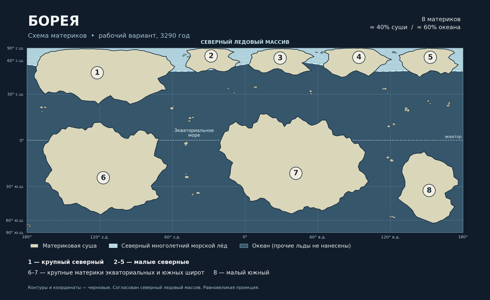

[Редактируемая геометрия материков, островов и предварительной северной кромки льда (GeoJSON)](maps/borea/continents_draft.geojson). Координаты условные, в градусах долготы и широты. Контуры измерены по равновеликой проекции. Расчётная доля суши близка к 40% поверхности. Остальной ледовый покров ещё предстоит нанести. Кромка северного льда является ориентиром для климатической разработки.

**Первый фрагмент карты (предложение).** Мелководное экваториальное море между двумя крупными материками сезонно освобождается ото льда. На одном берегу располагается относительно мягкая, преимущественно безлесная речная низменность. На другом — холодное нагорье с отдельными геотермальными долинами. У входа в море островная цепь образует несколько проливов. Состояние льда в проливах будет определять доступность берегов и сезонность прежних морских связей. Переправа и порт в 3290 году подлежат проработке с учётом фактически принятой транспортной техники.

### Тектоника и рельеф: рабочий вариант

**Решение автора от 26.11.2026:** тектоническая схема предварительно согласована как рабочая географическая основа на базе принятых очертаний материков. Схема не устанавливает окончательные границы плит, их скорости, абсолютную сейсмичность или высоты гор. Она показывает основные геологические контрасты, необходимые для разработки цивилизации.

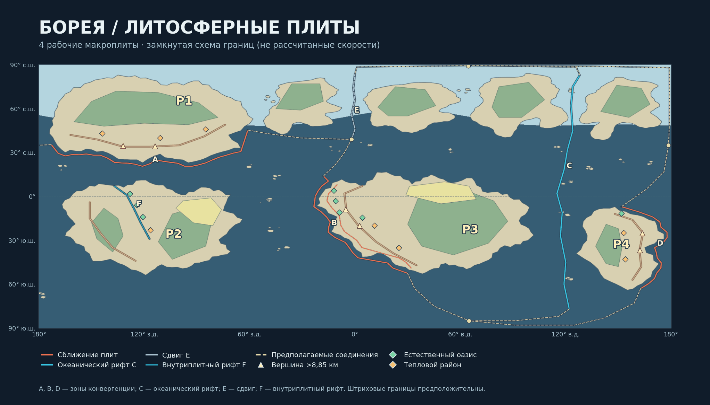

[Редактируемый слой тектоники и рельефа (GeoJSON)](maps/borea/tectonics_draft.geojson). Его следует использовать вместе со слоем материков; координаты и названия полей условны.

| Пояс | Размещение | Предлагаемые следствия |
|---|---|---|
| A | Южная окраина материка 1: сближение плит и локальная коллизия аккретированных континентальных фрагментов | Молодой широкий ороген с двумя предложенными сверхвысокими вершинами, геотермальные поля в предгорьях; активное побережье и более устойчивый северный внутренний массив |
| B | Западная окраина материка 7: субдукция и локальная коллизия плавучих террейнов | Прибрежная вулканическая дуга отделена от более внутреннего горного пояса со сверхвысокими вершинами; горячие источники на флангах дуги и в предгорных бассейнах; восток сравнительно спокойнее |
| C | Восточный океан между 7 и 8, далее между 4 и 5 | Океанический рифт, подводный вулканизм и локальные острова; влияние на рельеф дна и ледовые условия северных проливов подлежит уточнению |
| D | Восточная окраина материка 8: сближение плит и локальная коллизия края континента с плавучим террейном | Активная горная область с двумя предложенными сверхвысокими вершинами; тепловые поля западнее хребта; западная часть материка относительно устойчивее |
| E | Пролив между материками 2 и 3 | Сдвиговая зона, местная сейсмичность под многолетним морским льдом; необходимость контроля состояния ледовых путей |
| F | Западно-центральная часть материка 6 | Континентальный рифт с локальными геотермальными полями; старые горы западнее и сравнительно спокойные низменности восточнее |

Горы, вулканизм, рифты и сейсмические пояса логически связаны с характером движения литосферных плит (сопоставление с Землёй: [USGS, Understanding plate motions](https://pubs.usgs.gov/gip/dynamic/understanding.html)). Текущая карта дополнена замкнутой рабочей сетью границ четырёх макроплит; положение предположительных соединений и кинематика не утверждены (см. ниже). Геологически молодая и активная Борея не обязана быть одинаково опасной повсеместно: относительная устойчивость отдельных массивов совместима с общей высокой тектонической активностью планеты.

В наиболее активных зонах сохраняется малочисленное население. Тепло может передаваться от геотермальных полей в города на сравнительно устойчивых периферийных площадках; поле, вулкан и город не обязаны находиться в одном месте. Геотермальные воды не повсеместно выходят на поверхность, а локальное наличие тепла в высоких широтах не делает их климат тёплым. Точные условия должны определяться совместно с климатической картой. Богатство недр и транспортные связи сберегаются как отдельные факторы расселения.

**Экваториальное море:** восточный берег материка 6 предлагается сделать преимущественно равнинным и относительно спокойным; западный берег материка 7 — горным с геотермальными долинами. Оба берега могут быть экономически значимыми по разным причинам. На материке 7 также показаны северные низменности, близкие к наиболее мягким широтам. Морские шельфы, глубокие впадины, ледовая кромка и речные бассейны требуют последующей разработки.

### Климатическая карта и сезонный лёд: рабочий вариант

**Статус:** предложение от 26.11.2026. В основе — 0,75 земной инсоляции, ретроградное вращение, сутки 40 часов, наклон оси 18°, атмосфера 1,25 атм и уже установленные температурные диапазоны. Это схема региональных контрастов, не численный расчёт климата.

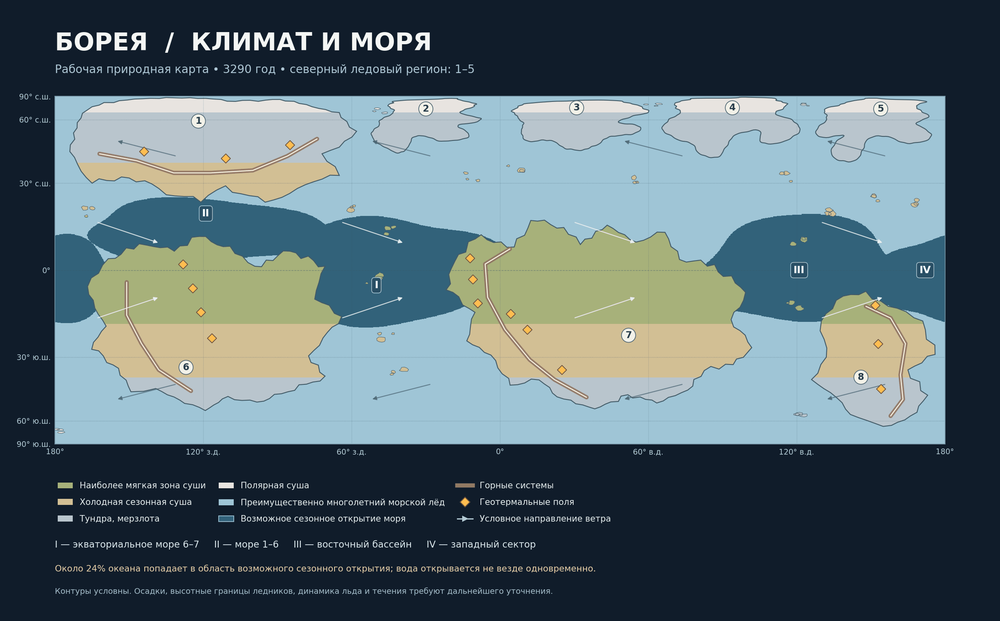

[Параметры и контуры условных зон](maps/borea/climate_draft.json) · [Скрипт воспроизведения карты](maps/borea/climate_draft.py) · [Интерактивный атлас Бореи](../../wiki/borea-globe.html).

Для изображения выделены ориентировочные широтные зоны: наиболее мягкая суша до ±18°, холодная сезонная суша до ±38°, тундра и мерзлота до ±65°, полярная суша выше. Это условная легенда, не фиксированные климатические изотермы. Границы будут меняться с рельефом, океаническими течениями и континентальностью. Высокогорья холоднее соседних низменностей; геотермальные точки не обозначают площади тёплого климата. Древесная растительность остаётся ограничена экваториальными геотермальными оазисами.

| Район | Предлагаемые климатические особенности |
|---|---|
| Восточные и северные низменности 6 | Короткий сезон оттаивания, более мягкие побережья; речные долины и прибрежные хозяйства. Внутренние районы холоднее и суше. |
| Запад 7 | Горный берег экваториального моря: при предполагаемых западных тропических ветрах наветренные склоны могут получать больше осадков. Геотермальные долины имеют отдельный микроклимат. |
| Север и внутренние районы 7 | Северные низменности — кандидат на крупный продовольственный район; за горным поясом возможны более сухие пространства. |
| 1–5 | Северный ледовый регион с холодными равнинами, полярными областями и местами горного оледенения. Не вся тундра и полярная суша покрыты сплошным материковым ледником. |
| 8 и юг 6–7 | Более холодные южные территории, локальные прибрежные и геотермальные поселения; земледелие преимущественно защищённое в самых холодных областях. |

**Атмосфера и моря.** Для первого эскиза предложен обратный относительно земного знак отклонения потоков: тропические ветры преимущественно с запада на восток, в средних широтах — наоборот. Реальное направление местных ветров и скорость океанических течений нельзя непосредственно вывести из ретроградности: температура, распределение материков, рельеф, солёность, плотность воды и морское дно требуют отдельной разработки. [NOAA, эффект Кориолиса](https://oceanservice.noaa.gov/education/tutorial_currents/04currents1.html) · [NOAA, движущие силы океанических течений](https://oceanexplorer.noaa.gov/ocean-fact/currents/). Несмотря на геотермальную активность, моря остаются холодными. Локальные полыньи и подлёдный перенос тепла не означают свободные ото льда океаны.

На схеме выделены четыре сектора возможного сезонного открытия воды (не обязательно четыре отдельные акватории):

1. Экваториальное море между материками 6 и 7.
2. Море между южной окраиной 1 и северным побережьем 6.
3. Восточный океанический бассейн между 7, 8 и низкими широтами северных материков.
4. Западный, пересекающий условный меридиан 180°, сектор океана.

По площади равновеликой сетки суммарная область возможного сезонного открытия составляет около 24% океана (около 126 млн км²), а не площадь фактически открытой воды в один момент. Морской лёд между материками 1–5 остаётся многолетним. Северный и южный сезоны противоположны; годовые максимумы и минимумы открытой воды пока не определены. Ранее предложенные 2–5% и 10–20% остаются гипотезой, не выводом из карты. Переключаемые сезонные состояния атласа — условные иллюстрации с учётом противоположных сезонов и запаздывания, а не утверждённые проценты льда.

**Вопрос для последующей физической сверки.** Канонические −8 °C как средняя глобальная температура, очень холодные континентальные зимы и преобладание морского льда требуют согласованного баланса по площади и сезонам. Отдельно учитываются температура поверхности морского льда, воды и атмосферного воздуха. Не следует считать среднюю температуру воды подо льдом средней температурой поверхности планеты. Сейчас каноническое значение не изменяется; точная площадь постоянного льда и границы температурных зон остаются предметом разработки.

**Интерактивная вики.** Атлас использует геометрию материков, тектонический и климатический слои из рабочего каталога карт. Доступны вращение планеты, приближение и переключатели географии, тектоники, климата, морского льда, физической карты высот и природных видов с атмосферой и без неё; для климатических и природных слоёв предусмотрены годовой обзор и четыре сезона. Новые слои будут добавляться по мере согласования географии и исторических регионов. Атлас помечен как рабочий, так как точные координаты, климатические зоны и будущие границы ещё уточняются.

### Природная текстура и физическая карта высот: рабочий вариант

**Статус:** визуальная и географическая разработка (26.11.2026), без окончательного утверждения отметок высот. Согласованные очертания материков, северный ледовый регион и рабочие тектонические пояса сохранены. Города, дороги, антропогенные изменения и ночная подсветка пока не нанесены.

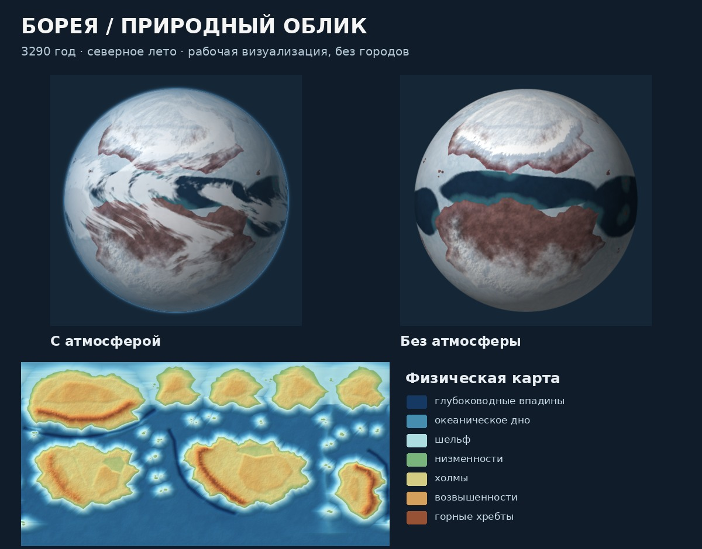

В интерактивном атласе добавлены три слоя:

- **Вид из космоса с атмосферой:** облачные полосы, холодная голубоватая дымка и тонкий атмосферный ореол. Снег, морской лёд, открытая вода и обнажённый грунт меняются при переключении сезонов. Атмосферное рассеяние стилизовано, а не рассчитано из спектра и оптических свойств атмосферы; ореол рисуется на глобусе отдельно от текстуры поверхности.
- **Поверхность без атмосферы:** тот же грунт, снег и морской лёд, но без облаков и атмосферной дымки. В областях с коротким сезоном оттаивания предполагается красно-бурая и серо-фиолетовая тундра, согласно описанию растительности Бореи; холодные океаны имеют глубокий тёмно-синий цвет.
- **Физическая карта высот и глубин:** тёмно-синие впадины, голубое океаническое дно и шельфы, зелёные низменности, охристые возвышенности, оранжево-коричневые хребты. Линии тектонических поясов служат основой для предварительного численного поля высот; на материках сохранены основные низменности и массивы. Первый эскиз ограничивал высоты примерно +5,1 км. По решению автора он пересмотрен: текущая рабочая модель даёт около −7,97…+9,85 км и шесть локальных вершин выше земного Эвереста. Точные отметки остаются предложениями (см. ниже). Геологические границы рельефа плавные, не тождественны очертаниям условных полигонов.

Природный годовой обзор показывает северное лето, а не объединённую область возможного открытия морей. Четыре сезонных состояния — иллюстративные, не физическая модель климата. Исходные оптические текстуры и физическая карта используют одни и те же географические координаты в равнопромежуточной цилиндрической проекции (2:1; 1536×768 в стандартном режиме и 3072×1536 в HD). В просмотрщике доступна загрузка текстур PNG для любого сезона; статические образцы северного лета обновлены до 3072×1536:

- [Поверхность без атмосферы](maps/borea/surface_texture.jpg)
- [Поверхность с облаками](maps/borea/space_texture.jpg) — атмосферный ореол не запекается в развёртку.
- [Физическая карта высот и глубин](maps/borea/relief_texture.jpg)

Гидрография предварительно построена следующим слоем, см. ниже. Настоящая модель не задаёт окончательные водоразделы, абсолютные глубины всех морей, экологические границы и политическое устройство. Рабочий относительный слой расселения разработан отдельно, см. ниже.

### Сверка рельефа, тепловых районов и расселения (3290)

**Решение автора от 26.11.2026:** несколько локальных вершин в различных зонах активного столкновения плит должны быть выше Эвереста. Геотермальные оазисы необходимо объяснять физически и связать с картами городов и относительной плотности населения. Общие принципы, включая редкие высоты более 8,85 км, отражены в [досье, IV.6–IV.7](../race_grondary.md#homeworld.geology). Следующие точные координаты, значения, схемы и названия-коды являются рабочими предложениями.

**Сверка с исходными параметрами.** Борея имеет массу 2,3 земной, радиус 1,3 земного, поверхностную гравитацию 1,35 g, возраст системы около 3,5 млрд лет, инсоляцию около 0,75 земной, среднюю температуру около −8 °C и плотную атмосферу 1,25 атм; сверены [IV.1–IV.7 досье](../race_grondary.md#homeworld.overview) и [справочник систем](../reference_spravochnik_sistem.md). Значения температуры и ледового покрова продолжают требовать физической сверки; новая модель рельефа не является моделью климата.

#### Рельеф и тектоника

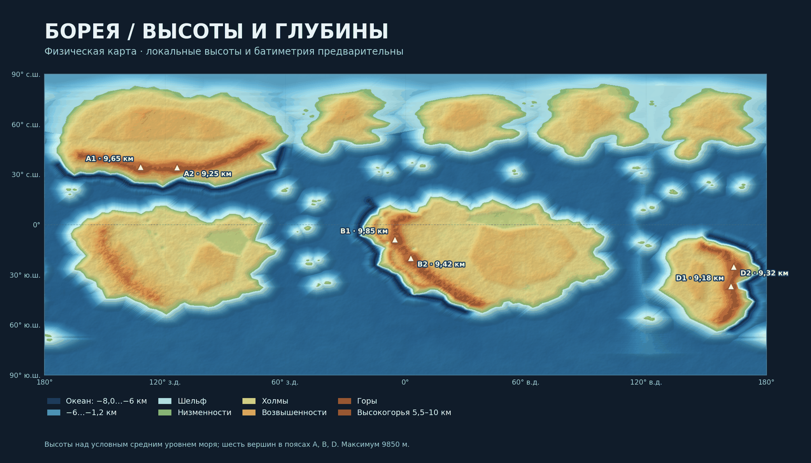

Повышенная гравитация усложняет существование высоких гор. Простая оценка нагрузки характерного столба породы через `ρgh` при ρ≈2700 кг/м³, g≈13,2 м/с² и h≈9,85 км даёт около 350 МПа; это не критерий разрушения реального горного массива, а иллюстрация масштаба нагрузки. Нельзя автоматически увеличивать максимальную высоту только потому, что планета моложе. Предлагаемая геологическая оговорка: короткоживущие относительно геологических эпох особо высокие вершины возвышаются над широкими, уже поднятыми до нескольких километров массивами утолщённой коры. Условная местная отметка основания порядка 4–5 км означает существенно меньший локальный рельеф, чем абсолютные 9–10 км. Коллизионное поднятие поддерживается продолжающимся сокращением коры; глубокие изостатические корни распределяют нагрузку. Упрощённая оценка Airy (ρ коры≈2700, мантии≈3300 кг/м³) даёт порядка 18–23 км дополнительного корня для возвышенности 4–5 км; реальные коровые параметры Бореи пока не установлены. Холод может замедлить химическое выветривание, но ледники и морозное разрушение по-прежнему активно разрушают рельеф. Поэтому такие вершины редки и ограничены локальными ядрами A, B и D. Земные аналоги: [USGS — утолщение коры и эрозионное равновесие Гималаев](https://pubs.usgs.gov/publication/70271381), [оценки предельной высоты гор и зависимости от гравитации](https://doi.org/10.1016/j.geomorph.2025.110144).

| Пояс | Вершины-кандидаты (над уровнем моря) | Геологическая причина |
|---|---|---|
| A, материк 1 | A1 — 9650 м; A2 — 9250 м | Локальная континентальная коллизия и аккреция микроконтинентальных блоков в широком молодом орогене |
| B, материк 7 | B1 — 9850 м; B2 — 9420 м | Субдукция с локальным столкновением плавучих континентальных фрагментов; высокий внутренний массив не отождествляется с прибрежной вулканической дугой |
| D, материк 8 | D1 — 9180 м; D2 — 9320 м | Локальная коллизия края континента с аккретированным блоком, узкий утолщённый горный массив |

Высокие вершины размещены на линии ранее принятых молодых гор, а не в стабильных равнинах или рифте F. Крупный рельеф старых гор материка 6 остаётся ниже; континентальный рифт не превращён в коллизионные горы. Морские фронты A, B, D уточнены ближе к соответствующим берегам без пересечения их материковых полигонов (рабочие границы дополнены предположительными соединениями, см. ниже); B дополнен отдельной прибрежной вулканической дугой. На стабильных участках и в северных проливах сохраняются относительно мелководные шельфы, вдоль активных фронтов — более крутые склоны и глубоководные впадины, вдоль C — поднятый океанический рифт. Крупные горы и небольшие природные низкие долины должны согласовываться на следующем этапе с осадками, ледниками и речными бассейнами.

#### Где находятся оазисы и почему

Геологическая активность даёт повышенный доступ к теплу, но горячая порода сама по себе не создаёт оазис. Для естественного выхода нужны (1) источник глубинного тепла, (2) трещиноватость и проницаемые водоносные горизонты, (3) постоянная подпитка водой (подземная циркуляция, талые воды, местные осадки), (4) сравнительно низкая защищённая долина с достаточно мягким широтным климатом. Земные аналоги взаимосвязи температуры, проницаемости и гидрологической подпитки: [USGS, Dixie Valley](https://www.usgs.gov/publications/which-geologic-factors-control-permeability-development-geothermal-systems-geologic), [USGS, тепловой поток и подпитка вод](https://www.usgs.gov/publications/heat-flux-magmatic-hydrothermal-systems-related-availability-fluid-recharge).

Тёплый микроклимат +5…+15 °C в каноне описывает **локальные природные экваториальные оазисы**, а не весь окружающий макрорегион, мегаполис, горный пояс или промышленное поле. Для примера масштаба: условный поток 50–100 Вт/м² на 1 км² требует 50–100 МВт тепла; реальные потери через ветер, испарение, грунт и снег зависят от местных условий. Поэтому на планетарной карте показываем районы потенциальных систем, в которых тёплыми являются небольшие долины, источники, берега и защищённые участки; их размеры и мощность пока неизвестны. Высокоширотное поле может греть водопровод, промышленность и здания, но не превращать весь район в естественный лесной оазис.

| Материк / пояс | Тепловые районы (рабочие ID) | Из них естественные оазисы-кандидаты | Механизм и роль |
|---|---|---|---|
| 1 / A | G01–G03 | — | Вторичные трещины предгорий широкого орогена, глубинные воды и интрузии; производственная теплоэнергетика, холодная поверхность |
| 6 / F | G04–G07 | G04–G06 | Теплоподвод рифта и проницаемые боковые разломы на рифтовом плече, циркуляция вод в экваториальных низких долинах; исторические очаги |
| 7 / B | G08–G13 | G08–G11 | Магматическая дуга субдукции, периферийные гидротермальные системы, внутренние вторичные разломы орогена и защищённые долины; исторические очаги |
| 8 / D | G14–G16 | G14 | Локальные фланговые гидротермальные районы; только северный участок близких к экватору широт подходит как кандидат оазиса |
| 2–5 | Не выделены на текущем масштабе | — | Стабильные холодные массивы; удалённые посёлки возможны при современной энергетике и снабжении. Отсутствие символа не означает физического отсутствия всех глубинных ресурсов |

Итого 16 обозначенных тепловых районов, восемь кандидатов естественных оазисов, расположенных в пределах условного мягкого пояса ±18°. Точные места выходов воды, фильтрация пород, солёность, мощность, питание и площадь тёплых земель не моделировались. Подробное местное районирование требуется отдельно. Зеленый символ — район возможного оазиса; янтарный — ресурс тепла без утверждения тёплого наземного микроклимата.

#### Города и относительная плотность населения

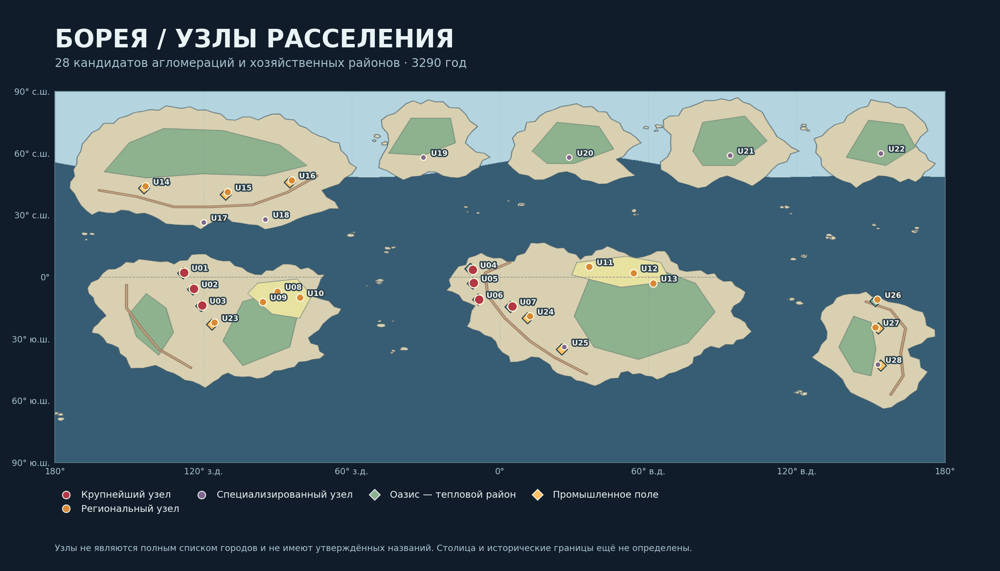

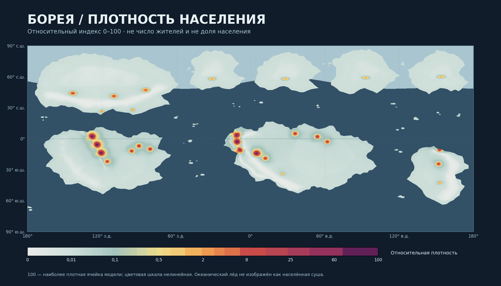

Сверено с [IV.13](../race_grondary.md#homeworld.demography), [VIII.6](../race_grondary.md#culture.visual-style), [V](../race_grondary.md#nutrition) и описанием жизненного уклада в [X](../race_grondary.md#society): около 3 млрд грондаров на Борее в общем позднем срезе, высокая урбанизация, преимущественно города экваториально-геотермальных зон; удалённое расселение возможно, но дороже. Наиболее сейсмически активные зоны заселены слабо. Метрополия снабжается преимущественно сама. Современные поселения не являются прямым отображением исторических расовых ареалов.

Предложенный слой содержит 28 представительных **узлов** (не перечень всех отдельных городов): семь крупнейших агломерационных кандидатов U01–U07 на 6 и 7 вокруг экваториальных тепловых районов, региональные узлы в мягких земледельческих низменностях, а также холодные специализированные центры в промышленных и логистических районах. Сами поля и городские площадки разведены: безопасные участки на устойчивых террасах, долинах и относительно спокойных флангах, а не на вершинах, кратерах или непосредственно на наиболее активных разломах. Рабочие точки U01–U07 после сверки высот и условной сейсмичности лежат примерно на 498–955 м; их привязка к региону тепла не означает общую тепловую магистраль на сотни километров. В масштабе планеты точки обозначают районы; локальные источники, городские площадки, резервные энергетические системы и расстояния уточнятся на региональных картах. Тепловой район может снабжать электроэнергией более обширную территорию, чем непосредственно пригодна для передачи тепла.

Относительный индекс плотности в атласе нормирован так, что 100 соответствует наиболее плотной ячейке модели. Используется нелинейная цветовая шкала, чтобы показать как разреженные сельские районы, так и густые агломерации. Индекс зависит от расстояния до опорных узлов и источников тепла, широты, высоты, условной близости к активным зонам, пригодности низменностей и диффузной периферии населённых центров. Выше 6 км общая модель не показывает постоянное население. Это **не число жителей на км², не доля населения и не перепись**. Параметры подобраны для соответствия канонической преимущественной концентрации в крупных экваториальных тепловых узлах, а не для вывода точных пропорций. Внутренние диагностические отношения модели не являются каноническими долями.

[Геоданные тепловых районов и вершин (GeoJSON)](maps/borea/tectonics_draft.geojson) · [Геоданные опорных узлов (GeoJSON)](maps/borea/settlements_draft.geojson) · [Диагностика высот и площадок](maps/borea/validation_draft.json). В интерактивном атласе включены отдельные переключатели высот, тепловых районов, узлов расселения и плотности; нажатие на метку открывает описание. Природные виды из космоса остаются без городских огней и строений. Названия, точное население городов, исторические границы и положение Дерадана не утверждены.

**Следующий приоритет:** согласовать предварительную гидрографию и транспортную сеть, уточнить водный баланс, питание источников, пригодность речных долин и ресурсы. После этого привязать исторические ареалы четырёх внутривидовых рас, единый анклав бункерных и Дераданскую землю; лишь затем фиксировать топонимы, административные районы, городские связи и количественную демографию.

### Гидрография, сезонный лёд, дороги и оптические виды (3290)

**Уточнение автора 26.11.2026.** На природном виде должны быть различимы геотермальные оазисы; нужны дневная и ночная развёртки поверхности без атмосферы с городами и дорогами, карта льдов и морей по сезонам вместе с гидрографией, более высокое разрешение текстур и границы плит. Существующие контуры материков, зоны оазисов G01–G16, высоты и 28 опорных узлов не заменены. Новые конкретные маршруты, очертания ледников, котловины и соединения границ — **рабочие предложения**, а не новые утверждённые планетологические факты.

#### Рабочая сеть литосферных плит

Шесть принятых тектонических поясов A–F сохранены. A, B, D — конвергенция, C — океанический рифт, E — сдвиговая зона. F остаётся внутриматериковым рифтом внутри макроплиты P2 (раскол ещё не считается завершённым). Штриховые океанические соединения X01–X10 являются предложениями о недостающих границах; их кинематический режим не задан. Сеть из трёх протяжённых цепей между северным и южным океаническими узлами и перемычки A образует четыре рабочие макроплиты: P1 — северо-запад, P2 — юго-запад, P3 — центрально-восточная часть, P4 — восток. Топология имеет четыре тройных узла J-N, J-S, J-W, J-E, нет висячих концов; обе стороны условного меридиана 180° соединены. Проверено, что новые соединения не пересекают внутренние области восьми крупных материков. Такая сеть не определяет ещё реальные векторы и скорости движения, коровые микроплиты, трансформные разломы и историю аккреции. [Редактируемый слой](maps/borea/tectonics_draft.geojson).

#### Гидрография и лёд

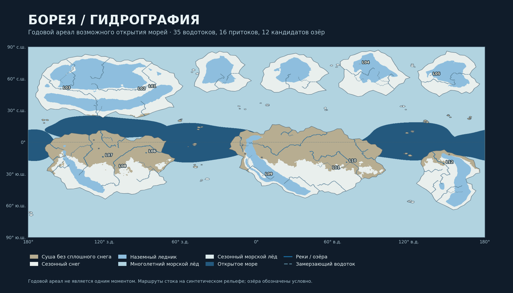

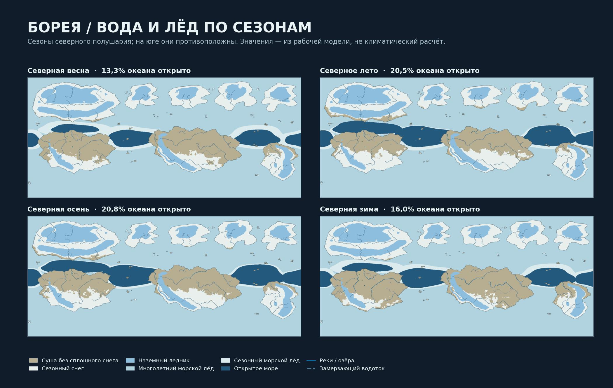

Слой получен из той же синтетической численной модели высот, что и физическая карта. Сетка маршрутизации 768×384, на глобальном масштабе не разрешает реальные речные долины или озёрные берега. Условное распределение осадков и талых вод учитывает широту, близость моря и горы. Метод заполнения замкнутых понижений Priority-Flood формирует пути стока к побережьям ([Barnes, Lehman, Mulla](https://doi.org/10.1016/j.cageo.2013.04.024)); проверено убывание заполненной поверхности по направлению от верховьев к выходу. Низины, которые могли бы задерживать воду, рассматриваются отдельно. Нанесены 35 представительных основных водотоков, 14 притоков и 10 кандидатов озёрных котловин. Это не полный список рек и не измеренные русла; предполагаемые озёра обозначены символом, без установленной площади зеркала, солёности и водного баланса. Устья доведены до ближайшей береговой ячейки. Точки и линии не выходят за материковые полигоны. После согласованной переработки берегов 2–5 сток этих четырёх материков пересчитан; гидрографические и транспортные объекты материков 1 и 6–8 сохранены с прежней геометрией и идентификаторами.

Согласно IV.6 и IV.7 досье, высокие горы, преобладание снежных осадков, холод и циркуляция нагретых подземных вод требуют различать поверхностный сток и гидротермальную подпитку. Снеготаяние в низких и средних широтах даёт сезонные водотоки, высокогорные и полярные ледники — потенциальные источники талой воды, а защищённые геотермальные долины способны иметь локальные незамерзающие участки. Геотермальная вода может быть минерализованной; нельзя считать всю её пригодной для питья и орошения. Подземные источники и трассы питающих водоносных горизонтов ещё не рассчитаны, и главный речной маршрут не равен границе гидротермального водосбора.

Отдельный слой `Гидрография · моря, лёд, воды` показывает многолетний наземный ледник, сезонный снег, открытое море, сезонный морской лёд, многолетний морской лёд, условно замерзающие водотоки и озёра. Многолетнее наземное оледенение в рабочей высотно-широтной модели занимает около 20,8% суши, это не установленная доля. Предварительные морские карты используют прежние согласованные пояса возможного открытия моря:

| Снимок рабочего сезона | Открытая вода от площади океана (условная модель) |
|---|---:|
| Северная весна | 13,3% |
| Северное лето | 20,5% |
| Северная осень | 20,8% |
| Северная зима | 16,0% |
| Объединённый годовой ареал возможного открытия | 24,3% (не единовременная площадь) |

На юге сезон противоположный; северный многолетний ледовый регион сохраняется. Запаздывание таяния задано условной моделью, а не выведено из гидродинамического расчёта. Замёрзшая поверхность реки не означает прекращение подлёдного стока. Границы ледников, солёность и глубины озёр, разливы при снеготаянии и региональные объёмы осадков остаются открытыми. [Векторный слой гидрографии и транспортных связей](maps/borea/hydrology_transport_draft.geojson). Для воспроизведения рабочей DEM предназначен [экспортёр сетки](maps/borea/export_model_grid.cjs) (Node.js и дополнительный пакет @napi-rs/canvas); [расчёт стока и коридоров](maps/borea/hydrology_transport_revision.py) (Python, NumPy, SciPy, Matplotlib). Временные бинарные сетки не включены в репозиторий.

#### Дневная и ночная поверхность, транспортные связи

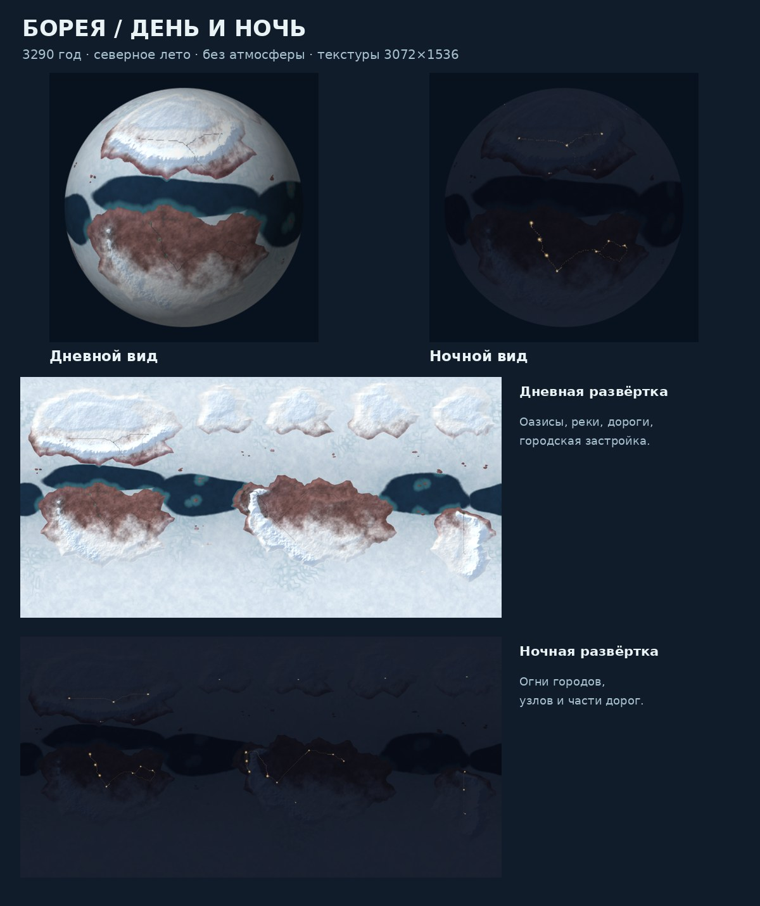

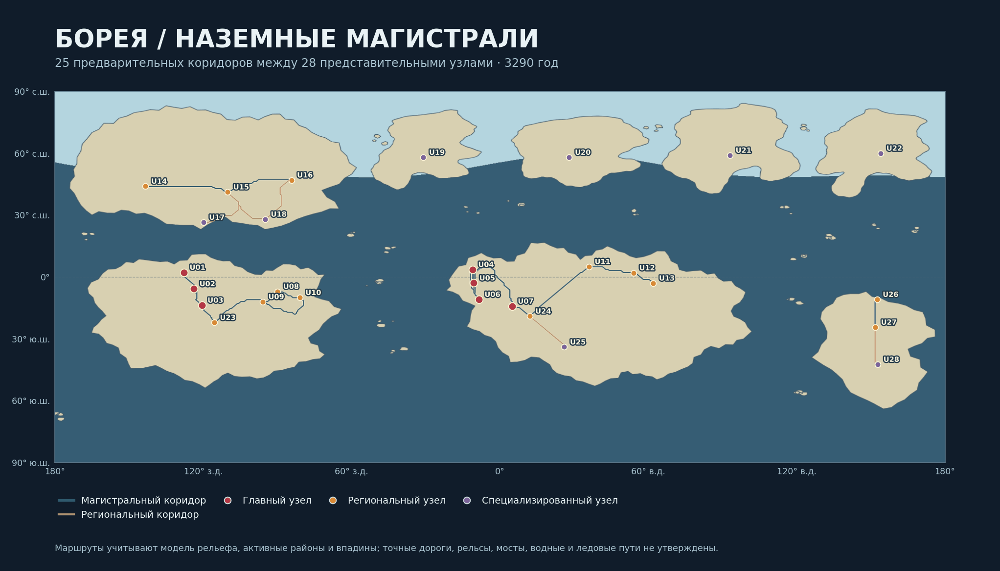

Нанесены 25 возможных наземных коридоров между опорными узлами. Связи строились внутри одного материка по синтетическому рельефу с учётом условной близости к активным зонам, возвышенностей, перепадов высот и озёрных депрессий. Все конечные пункты — предложенные узлы U01–U28. Проверено, что линии не проходят через море; проект не предполагает автоматически мосты и дороги между северными материками. В карте выделены главные и региональные связи. В соответствии с разделом досье о транспорте, крупнейший коридор может содержать автомобильную инфраструктуру и электрифицированную железную дорогу. Тип покрытия, точный профиль, мосты, туннели, ледовые дороги и морская или воздушная сеть подлежат локальной разработке.

Две дополнительные оптические карты без атмосферы используют одинаковые координаты и рисунок дорог. Дневная показывает серо-металлические городские и промышленные пятна, дороги, природный рельеф и открытые участки воды. Ночная — условную тёмную поверхность с огнями застройки и слабой прерывистой подсветкой обслуживаемых участков транспортных коридоров; это не одновременное ночное изображение всей реальной планеты. Яркость и визуальный размер застройки/магистралей увеличены для чтения на глобусе, не задают фактические ширины. Дорожная карта продолжается на земле, не проведена по морскому льду. Естественные оптические виды без городов сохранены отдельными режимами.

#### Оазисы на оптических текстурах и HD

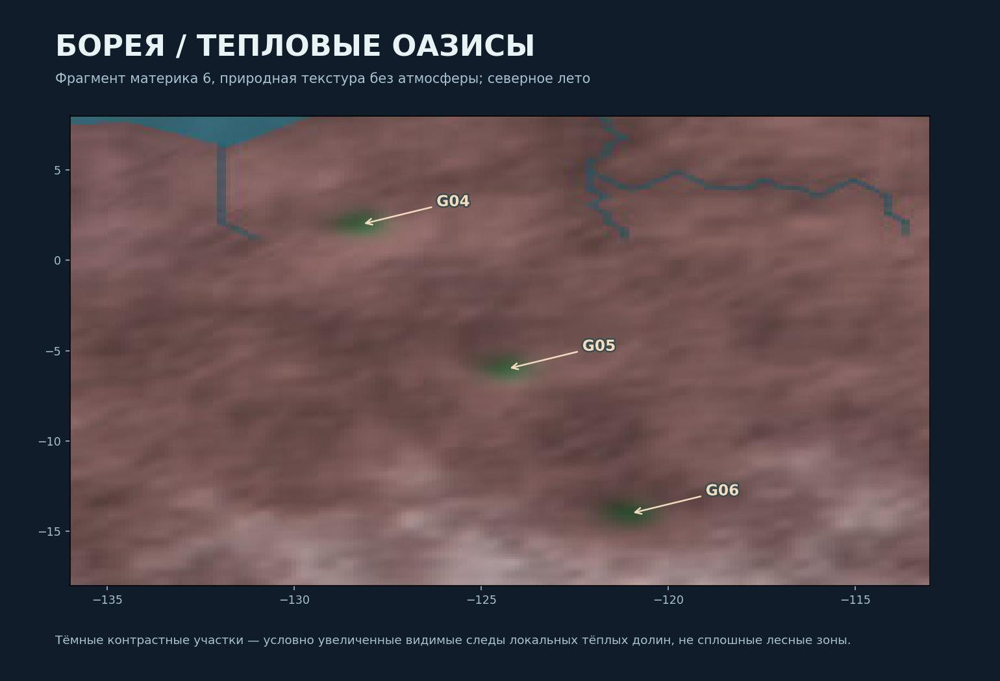

Восемь кандидатов естественных оазисов теперь имеют тёмные зеленовато-пурпурные участки в текстуре земли, с пониженным снежным покровом в холодный сезон. Это соответствует IV.7–IV.8 досье: локальный тёплый микроклимат и единственная древесная форма только в геотермальных экваториальных оазисах. Не добавлены леса в высоких широтах и открытые тёплые моря от промышленных полей. Для различимости на планетарном масштабе оптический след района немного увеличен и не является реальной площадью естественного оазиса. В облачном режиме часть оазисов может быть прикрыта облаками. Отдельная опция «Метки оазисов» позволяет увидеть положения без изменения исходной текстуры.

Стандартный режим 1536×768 сохранён для телефона; выбираемый HD 3072×1536 позволяет более подробно приблизить глобус и выгрузить PNG текущего слоя. Увеличение разрешения не добавляет вымышленных детальных геоданных: гидрография и дороги по-прежнему основаны на рабочей модели, а не на локальной топографии. HD требует больше памяти. Образцы северного лета в формате 2:1: [день](maps/borea/day_texture.jpg), [ночь](maps/borea/night_texture.jpg), [природная поверхность](maps/borea/surface_texture.jpg), [облака](maps/borea/space_texture.jpg), [физическая карта](maps/borea/relief_texture.jpg). [Интерактивный атлас в вики](../../wiki/race_grondary.html#borea-atlas).

### Региональная география: осадки, вода, руды и сельское хозяйство (3290)

**Рабочий расчёт от 26.11.2026, представленный на согласование.** Географический каркас, принятые материки, плиты, существующие водотоки, 16 тепловых полей и 28 узлов не изменены. Слои построены на общей DEM атласа, уменьшенной до 768×384 ячеек; вблизи экватора это примерно 68 км на ячейку, к полюсам продольный масштаб сокращается. Они позволяют выбрать районы для дальнейшего описания, но не идентифицируют реальные низины, почвы, запасы или площади пашни в таком масштабе. При выводе в HD геометрия не становится детальнее. Суммарная площадь суши в этой более грубой растровой сетке ≈346 млн км² — расхождение с принятыми ≈40% связано с дискретизацией берегов, а не с изменением материков.

#### Осадки и климатические контрасты

[Карта годового потенциала осадков](maps/borea/regional_precipitation.png). Холодная планета с преимущественно ледовым океаном имеет ограниченный источник атмосферной влаги. Наибольшее испарение связано с сезонно открывающимися акваториями, не со всей областью возможного открытия одновременно. Простая сценарная модель переноса влаги использует среднюю условную долю открытой воды по четырём состояниям существующего ледового слоя, уменьшение влагоёмкости воздуха к полюсам и два противоположных зональных обхода с переходными широтными полосами. Тропический перенос преимущественно запад–восток, среднеширотный противоположен; при подъёме над горами осадки усиливаются, на подветренных склонах влага истощается. Это согласуется с ранее выбранной рабочей гипотезой о ретроградном вращении, но не является расчётом реальной циркуляции 40-часовой планеты. Индекс 0–100 логарифмический (99-й перцентиль необрезанного модельного потенциала соответствует 100), без привязки к мм/год. На большей части суши осадки выпадают преимущественно снегом, дождевые осадки в тёплый период характерны в первую очередь для экваториальных полос; локальные оазисы имеют собственный микроклимат.

В этом варианте запад 7 — наиболее выраженная наветренная область, северо-запад 6 и север 8 тоже получают влагу от сезонно открывающихся вод. Части внутренних территорий, особенно за горными поясами, значительно суше. Север 1–5 — маловодная ледовая и тундровая периферия: малое количество осадков не означает отсутствия накопленного за тысячи лет льда. Земледельческая пригодность не обязана совпадать с максимумом осадков: крутые холодные горы отдают талую воду низменностям.

#### Водные ресурсы, сток и геотермальная подпитка

[Карта поверхностной водообеспеченности](maps/borea/regional_waterResources.png). Отдельно рассчитан условный годовой потенциал стока из осадков с ограничением на жидкую воду, хранением части воды в многолетнем льду и сезонностью оттаивания. Накопление стока выполняется по понижению заполненной DEM (Priority-Flood), с весами площадей ячеек. Проверены балансы относительного поступления и суммарного выхода к побережьям и совпадение количества основных водотоков (35). Их прежние трассы и 14 притоков/10 озёрных кандидатов сохранены; [диагностика](maps/borea/regional_summary.json) содержит сопоставление выходов условной модели с устьями всех 35 основных рек. Рабочие размеры бассейнов и индекс водности полезны для сравнения, но не устанавливают площадь реальных бассейнов или расход в м³/с.

Для поселения имеют разное значение (1) осадки непосредственно над хозяйством, (2) талый и речной сток с возвышенностей, (3) накопление и перераспределение воды инфраструктурой, (4) глубинные горизонты, в том числе гидротермальные. Последние пока не рассчитаны. Сезонное оттаивание поверхностного слоя мерзлоты, снеготаяние и лёд рек требуют сезонных накопителей; ледник — запас, а не гарантированный ежегодный ресурс. В холодных районах предлагаются подземные/теплоизолированные водохранилища, защищённые водозаборы, замкнутые циклы технической воды и резервные линии между узлами. В городе при наличии тепла растапливание льда и опреснение, очистка и резервирование делают поселение возможным даже при скудном естественном стоке, но требуют энергии. На геотермальных полях термальная минерализованная вода не заменяет питьевую: водозабор, теплообмен, очистка и возврат теплоносителя проектируются как раздельные системы. Земледельческие долины нуждаются в орошении, защите от сезонного паводка и проверки состава грунтов.

Для всех G01–G16 произведён сравнительный скрининг потенциальной подпитки: окно радиусом 400 км, относительные осадки и прилегающие возвышенности. Это **не граница водоносного горизонта и не доказательство дебита**. Группы в текущем варианте:

| Геотермальные поля | Условия | Следствие для региональной разработки |
|---|---|---|
| G08–G10, запад 7 | Наиболее благоприятное сочетание морского переноса влаги и высоких питающих склонов | Есть предпосылки для естественных выходов и древнего оседлого расселения; на горном берегу необходимы безопасные площадки. |
| G04–G05, рифт 6; G14, север 8 | Умеренный потенциал | Локальные талые и подземные воды, накопление, более длительная циркуляция и слабопроницаемые экраны с проницаемыми разломами — гипотезы для региональной схемы. |
| G06 и G11 | Ограниченная оценка фоновых осадков, при этом это кандидаты естественных оазисов | G06: предложена дальняя подпитка рифтового плеча талым снегом и глубинным притоком вдоль проницаемого горизонта; местного ледника в окрестности 400 км модель не выделяет. G11: предложена подпитка через трещиноватые предгорья от возвышенных снегосборов и ближайших ледников (около пятой части рабочей окрестности). Оба оазиса локальны, влажный микроклимат создают выходы воды и тепла, а не высокий фон осадков. Конкретные горизонты, устойчивость и дебит нужно проверить на региональной карте. |
| G01–G03, G07, G12–G13, G15–G16 | Холодные и/или более сухие промышленные поля | Возможна эксплуатация глубинного тепла без тёплого природного микроклимата; промышленное тепло и оборотный теплоноситель не означают изобилие пресной воды. |

#### Минеральная и энергетическая география

[Карта перспективных геологических обстановок](maps/borea/regional_mineralResources.png). Сохранены пять основных канонических металлов (Fe, Ni, Cu, V, Cr) и древнее использование шельфовых метанклатратов. На карте нет подтверждённых рудников, содержания руд, запасов и объёмов добычи. Не вся гора является рудным телом и не каждый разлом несёт полезную минерализацию; активная тектоника поднимает и вскрывает конечные месторождения, а не мгновенно восполняет ресурс. Богатство молодой Бореи объясняет доступность новых районов и самостоятельность метрополии в 3290, не отменяя историческое истощение наиболее удобных поверхностных жил.

| Рабочая геологическая обстановка | Возможная специализация | Ограничения |
|---|---|---|
| Устойчивые массивы 1–8 | Железо; Fe–V-руды при наличии древних магматических и железистых комплексов, локальные Ni/Cr в основных и ультраосновных телах | Требуется минералогическая карта; не все устойчивые массивы содержат одинаковые залежи. |
| Молодые коллизионные пояса A, B, D и старые горы 6 | Вскрытые рудные комплексы, Fe, Ni/Cr при соответствующих породах | Прямо в активных горных поясах добыча рискованна, переработка и крупные населённые пункты вынесены на устойчивые участки. |
| Вулканическая дуга B на 7 | Медные магматогидротермальные системы | Не вся дуга минерализована, тепло и рудообразование не тождественны. |
| Континентальный рифт F на 6 | При наличии основных интрузий Ni–Cu, Fe–V и Cr; тепло на периферии магматической системы | Нужна отдельная история интрузивных комплексов и глубин. |
| Модельные холодные осадочные окраины шельфа (350–1500 м) | Кандидаты месторождений метановых гидратов | Только гипотеза на части относительно спокойных материковых окраин; давление и температура недостаточны без источника газа и подходящих осадков. |
| Океанический рифт C | Подводные Cu-сульфидные системы как дополнительная гипотеза | Не установлены наличие, масштаб или промышленная разработка. |

Земные аналоги использованы для отбора геологических условий, а не переноса точных запасов: [USGS — порфировые медные системы](https://www.usgs.gov/data/a-global-database-porphyry-copper-deposits-and-prospects), [USGS — основные и ультраосновные никель-медные интрузии](https://www.usgs.gov/publications/occurrence-model-magmatic-sulfide-rich-nickel-copper-platinum-group-element-deposits), [USGS — геологические типы минерализации, Fe–V и Cr](https://pubs.usgs.gov/of/2020/1042/ofr20201042_table1.pdf), [USGS — газогидраты и морские осадки](https://www.usgs.gov/programs/coastal-and-marine-hazards-and-resources-program/science/gas-hydrate-and-environment).

Исторически крупные добывающие и перерабатывающие центры могли возникать раздельно: рудник рядом с телом руды, безопасный металлургический комплекс у тепла, воды и магистрали. В 3290 году у грондаров есть развитая энергетика и возможность автономной добычи вдали от оазисов; климат, сейсмика, уборка снега, геотехническое обследование, резервирование и транспорт определяют её экономику. Наследие прежних выработок и промышленный металлолом дополняют первичную добычу. Поставки с колоний не являются необходимой основой повседневного снабжения Бореи.

#### Земледелие, пастбища и продовольствие

[Карта природной пригодности](maps/borea/regional_agriculture.png). Для открытого хозяйства проверяются условная длительность оттаивания и летний тепловой потенциал, высота и локальный рельеф, естественная водообеспеченность, отсутствие многолетнего ледника и относительная сейсмичность. Температурная функция — рабочий широтно-высотный суррогат с усилением полярного охлаждения, не новая карта изотерм и не климатическая норма; природные оазисы не растягиваются на весь материк. Пороговые значения отбирают территории для изучения, а не служат агрономическим прогнозом. Плодородие, засоление, доступность земель, редкие виды и пригодные культурные растения ещё не определены.

| Категория | Доля суши в рабочей сетке | Что означает в 3290 |
|---|---:|---|
| Лучшие кандидаты открытого земледелия | ≈2,9% (≈10 млн км²) | Относительно низкие долины, поймы и равнины с теплом и водой; интенсивная механизация, дренаж и орошение возможны. |
| Условные сезонные участки | ≈16,5% (≈57 млн км²) | Холоднее или суше, потребуется выбирать устойчивые местные культуры, укрытия и водные системы; не вся площадь освоена. |
| Пастбища и промысловая тундра | ≈37,8% | Кандидаты сезонного выпаса, заготовок кормовых растений и местного промысла; фактическая продуктивность и домашние виды не утверждены. |
| Преимущественно защищённое хозяйство | ≈22,4% | Грунт и климат ограничивают открытые поля; фермы, склады и переработка при надёжной энергии, особенно у тепловых полей. |
| Ледники и высокий сложный рельеф | ≈20,5% | Нет предпосылок для регулярного крупного открытого земледелия; точечное защищённое производство технически возможно там, где оно оправданно. |

Проценты — результат модели кандидатов, не доля реальной пахотной или населённой земли. Даже значительная условная площадь не означает высокой урожайности на холодной планете. Культуры и животные будут определены по биосфере, холодоустойчивости, пищевому рациону и практикам грондаров, а фактическое размещение и объёмы — по населению и логистике. Предлагается специализация сельских поселений: открытые полевые хозяйства в долинах; фермы защищённого грунта и переработка у доступного тепла; смешанные пастбищно-промысловые деревни на тундровых равнинах; прибрежные и подлёдные промысловые базы с переработкой, хранением и регулированием улова. Промысловая рыба и шерстяные гиганты уже описаны в досье; их массовое одомашнивание не предполагается автоматически. Древесная растительность остаётся ограниченной природными экваториальными оазисами.

#### Рабочий региональный профиль материков

| Материк | Природная основа | Вероятное современное хозяйственное значение (предложение) |
|---|---|---|
| 1 | Южные горы A, три промышленных тепловых поля, холодные и ледниковые внутренние районы | Тепловые и горнодобывающие узлы в предгорьях, промысловые поселения, переработка и южные долины; заселение разрежено относительно 6–7. |
| 2 | Высокие северные широты, устойчивый массив, крайне короткий сезон | Узловые специализированные поселения, защищённое продовольственное хозяйство и подлёдный промысел; геологоразведка. |
| 3 | Северный устойчивый массив восточнее сдвигового пояса E | Добыча на разведанных участках, ледовая логистика, научно-промысловые центры; наиболее активная окраина заселена слабо. |
| 4 | Северный массив и широкие ледовые моря | Ресурсные и ремонтно-логистические поселения, сезонная наземная и ледовая доступность; местные закрытые фермы. |
| 5 | Восточный северный массив, ледовый океан | Специализированные хозяйственные центры, морской промысел, ледовые маршруты; возможны небольшие автономные поселения. |
| 6 | Рифт F, более старые западные горы и восточные низменности; геотермически развитый экваториальный сектор | Один из двух основных аграрно-промышленных поясов: открытые поля и орошение в низменностях, защищённые фермы и предприятия у тепловых районов. |
| 7 | Западная влажная дуга B, высокие горы, относительно мягкие северные низменности и устойчивый восточный массив | Другой основной аграрно-промышленный пояс: наветренные источники воды, оазисы и промышленные узлы; поля прежде всего на безопасных северных равнинах и в долинах, а не у активных кратеров. |
| 8 | Северный оазис G14, восточный коллизионный пояс D, более спокойная западная часть | Региональные геотермальные и добывающие узлы, ограниченные поля с водными ресурсами на севере и на западных площадках, защищённое хозяйство южнее. |

В этой модели 6 и 7 вместе дают около 63 млн км² лучших и условных кандидатов для открытого хозяйства из примерно 67 млн на всей грубой растровой сетке. Это аргумент в пользу их роли в снабжении метрополии, а не рассчитанный объём производства или обязательное распределение населения. Предложенные геотермальные города на сухих участках должны получать часть воды и продовольствия из подходящих долин; специализация и баланс между местными фермами и межрегиональными перевозками будут установлены позднее. Север сохраняет население благодаря самостоятельной энергетике, добыче и транспорту, а не обязан импортировать всё продовольствие с колоний.

**Атлас и воспроизводимость.** В интерактивном атласе доступны четыре годовых слоя: осадки, поверхностная вода, геологические ресурсы и сельскохозяйственная пригодность. На карте воды выбираются метки тепловых полей, на аграрном слое — существующие узлы расселения. Исходные [классифицированные растры](maps/borea/regional_draft.json), [сводные показатели](maps/borea/regional_summary.json) и [генератор](maps/borea/regional_geography.py) получены из общей сетки DEM и существующей гидрографии, без изменения предыдущих слоёв. Сезонные состояния видны на прежнем слое гидрографии; новые слои имеют годовой характер.

### Историческая география: рабочая карта

Разработка перенесена в отдельный [рабочий материал исторической географии](boreya_historical_geography.md). Предложены природные ареалы трёх древних линий и единый поздний B01 на восточном устойчивом массиве 6, шесть кандидатов поверхностных очагов выживания после −7000, четырнадцать опорных региональных ядер и кандидат HR10 для Дераданской земли в северных низменностях 7. В атлас добавлены четыре исторических слоя, включая современное смешение и региональное наследие; точные исторические границы и численные доли не устанавливаются. Согласованный географический каркас и существующие 28 городских узлов сохранены. Новые местоположения и исторические связи ожидают согласования.

## 5. Как перейти от природной схемы к политической географии

**Решение автора от 26.11.2026.** Детализация географии и лора продолжается. Разработка иллюстраций для этой работы отложена. Три предварительных концепта транспорта (поезд, гусеничный вездеход и атмосферный грузопассажирский аппарат) служат визуальными пробами.

Предлагаемый порядок:

1. Принцип узлового расселения с более ранней технической возможностью расселяться вне узлов и ростом стоимости жизни вдали от геотермальных источников согласован.
2. Разместить крупные материки, моря и хребты. Нанести климатические области, сезонные кромки льда и локальные геотермальные поля, затем разместить исторические ареалы четырёх внутривидовых рас.
3. Разместить несколько ключевых исторических регионов, включая Дераданскую землю; определить, какие особенности позволили регионам пережить откаты и почему они отличались политическим устройством.
4. Определить число и роли крупных агломераций и малых поселений как результат географии и истории, не назначать всем регионам одинаковые масштабы.
5. Уточнить распределение населения, хозяйственные специализации и главные связи между территориями.
6. Только после этого закреплять топонимы, выбирать пилотный город и переходить к местным институтам.

### Ближайшая задача

Очертания материков 2–5 согласованы и внесены во все слои атласа. Согласовать детальные рабочие слои плит, гидрографии, сезонного льда и наземных коридоров. Рабочие карты осадков, поверхностной воды, геологических перспектив и сельскохозяйственной пригодности представлены на согласование; закрепить предложенную региональную специализацию, согласовать предложенные механизмы локальной подпитки G06 и G11. Представлена [историческая география](boreya_historical_geography.md): ареалы, очаги выживания, B01 и HR10. Согласовать их и затем перейти к истории государств, современным регионам и поселениям.

После согласования исторических кандидатов уточнить историю региональных государств и их интеграцию в единую власть в 2320. Следующими шагами станут современная административная география, сеть городов, деревень и основные транспортные связи.

## 6. Открытые вопросы

- Как связать предложенные тепловые поля, горы, влажные и сухие низменности с историческими ареалами четырёх внутривидовых рас? Уточнить подпитку двух сухих кандидатов оазисов G06 и G11, водные балансы и фактическое размещение добычи.
- Какую роль в 3290 году играют моря и архипелаги: самостоятельные крупные центры населения или преимущественно периферия материковых агломераций?
- Рабочий скрининг дал ≈2,9% суши лучших и ≈16,5% условных кандидатов для открытого земледелия. Требуются почвы, реальные площади хозяйств, местные пищевые культуры, домашние животные, производительность, продовольственные связи и распределение сезонных запасов.
- Согласовать B01 на материке 6 и предложенный механизм подземного уклада, долгоживущей локальной подпитки и выхода в 1500–2000; уточнить геологию сети и её фактическую историю.
- Карта наследия 3290 показывает смешанные узлы и исторический контекст; уточнить реальные региональные концентрации и доли четырёх линий без превращения их в касты.
- Предложены 14 опорных историко-хозяйственных районов (не политические границы); согласовать географическое ядро Дерадана HR10 и определить реальное число регионов по истории.
- Какую агломерацию выбрать пилотной: административный центр Дерадана, другой большой город или узел, исторически принадлежавший автономному монархическому региону? Решение зависит от согласованной карты.

Новые названия, размеры городов, политические границы и распределение населения пока не вводятся в канон. Численные оценки открытой воды, окончательные контуры и площади материков, подробное объяснение климатической политики и технические варианты сохраняют статус рабочих предложений.
